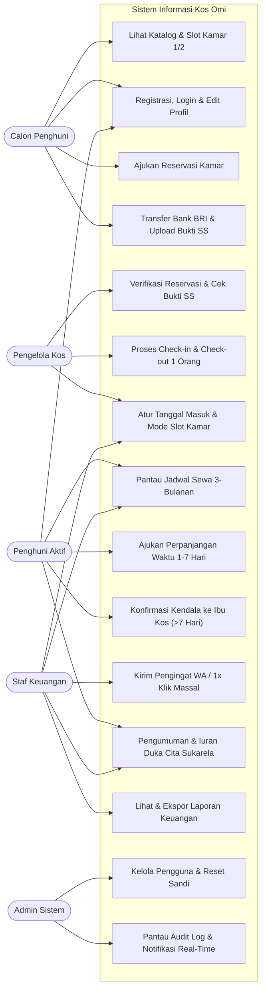
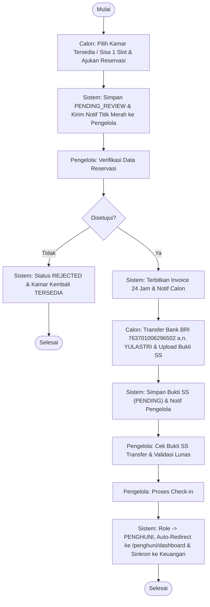
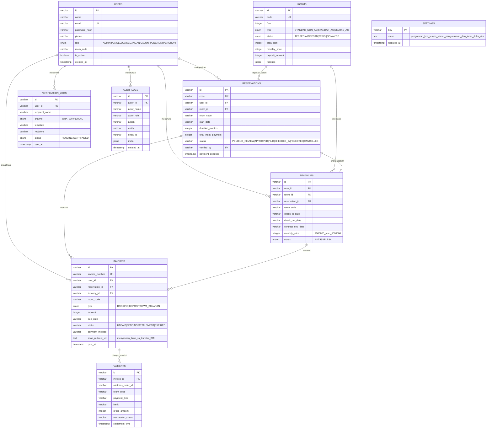

# Panduan Alur Sistem & Spesifikasi Diagram Laporan — Sistem Informasi Kos Omi (Versi Terbaru)

Dokumen ini disusun berdasarkan kondisi **sistem terbaru** yang sudah live di **https://kos-omi-padang.netlify.app** dengan rincian:
- **Arsitektur Folder:** Terpisah rapi antara Frontend (`src/frontend/`), Backend (`src/backend/`), Routing & API (`src/app/`), serta Dokumentasi (`docs/`).
- **Database:** Neon PostgreSQL (`9 tabel terpisah` pada [schema.ts](file:///d:/kos_omi/src/backend/db/schema.ts)).
- **Autentikasi & Privasi:** NextAuth v5 + Bcrypt Hash, isolasi sesi ketat per akun, **tanpa upload KTP/KTM/KRS** dan **tanpa input NIM**.
- **Pembayaran Resmi:** Transfer **Bank BRI `763701006296502` a.n. YULASTRI** (disertai unggah bukti screenshot transfer) + QRIS (*Segera Hadir*).
- **Kontak Ibu Kos:** Ibu Yulastri **`+62 813-7432-9562`**.
- **Notifikasi Real-Time:** Ikon lonceng dengan **titik merah + pop-up pesan + auto-refresh otomatis** pada seluruh 5 role tanpa perlu refresh manual.

---

## 1. Use Case Diagram (5 Aktor / Role)

| Aktor | Daftar Use Case |
| :--- | :--- |
| **Calon Penghuni** | • Melihat Katalog & Detail Kamar (termasuk kamar **`Terisi 1 Orang · Masih Butuh 1 Teman Sekamar`**) • Registrasi Akun & Login • Mengajukan Reservasi Kamar (pilih *Sendiri Penuh Rp 5jt*, *1 Slot Sendiri Rp 2,5jt*, atau *Berdua Gabung* — tanpa upload KTP/KTM/KRS) • Melihat Status & Timeline Reservasi + Menerima Notifikasi Otomatis (Titik Merah) • Transfer ke **Bank BRI `763701006296502` a.n. YULASTRI** & **Unggah Bukti Screenshot Transfer** • Mengajukan Reset Kata Sandi via WhatsApp Admin |
| **Penghuni Aktif** | • Otomatis diarahkan ke Portal Penghuni setelah di-Check-in oleh Pengelola • Login & Melengkapi/Edit Profil Pribadi (Nama, Email, WhatsApp, Kontak Darurat, Kata Sandi — tanpa NIM) • Melihat Informasi Kamar & Jadwal Sewa 3-Bulanan • Melakukan Pembayaran Sewa Bank BRI & Mencetak Kuitansi • Mengajukan Perpanjangan Waktu Bayar (**1–7 Hari** + Alasan) • Konfirmasi Kendala Langsung ke Ibu Kos (`+62 813-7432-9562`) via WhatsApp jika lewat 7 hari • Menerima Pengumuman **Iuran Duka Cita Sukarela** (bisa **Ikut Berdonasi Seikhlasnya via BRI** atau **Abaikan**) |
| **Pengelola Kos** | • Mengelola Katalog & Status Kamar (`TERSEDIA`, `DIPESAN`, `TERISI`, `NONAKTIF`) • Memverifikasi Reservasi Masuk (Setujui / Tolak) • Memeriksa **Bukti Screenshot Transfer Bank BRI** & Memvalidasi Pembayaran Lunas • Memproses **Check-in** (otomatis mengubah role menjadi `PENGHUNI` & masuk ke jadwal Keuangan) • Mengedit **Tanggal Masuk Kamar** (otomatis menghitung ulang jatuh tempo 3-bulanan) • Memproses **Check-out** per individu (jika 1 dari 2 teman keluar, dapat mengatur penghuni tersisa ke **`Mode: Butuh 1 Teman (Rp 2,5jt)`** atau **`Mode: Sendiri Penuh (Rp 5jt)`**) |
| **Staf Keuangan** | • Melihat Dashboard Ringkasan Pendapatan Sewa • Mengelola Jadwal Tagihan Sewa 3-Bulanan Per Kamar & Edit Tanggal Masuk • Mengirim Pengingat WA Per Kamar, **Kirim Pengingat Semua (1x Klik)**, dan Peringatan Final (>7 Hari) • Melihat Riwayat Pembayaran Sewa & Detail Transaksi • Menerbitkan **Pengumuman Iuran Duka Cita Sukarela** ke semua penghuni & memantau sumbangan masuk otomatis (terpisah dari pendapatan sewa) • Melihat & Mengekspor Laporan Keuangan (termasuk rasio konversi reservasi) |
| **Admin Sistem** | • Mengelola Seluruh Akun Pengguna 5 Role (Tambah, Ubah Role, Aktif/Nonaktif) • Mereset Kata Sandi Pengguna (Bcrypt Hash) • Memantau Log Aktivitas Sistem (`audit_logs`) & Log Notifikasi (`notification_logs`) • Mengelola Pengaturan Sistem Kos Omi |

### Visualisasi Use Case (Mermaid Flowchart)

---

## 2. Activity Diagram (5 Alur Proses Utama Terbaru)

### Alur A: Reservasi Kamar (Penuh / Slot 1/2), Upload Bukti SS BRI, Validasi, hingga Check-in Otomatis
**Swimlane:** `Calon Penghuni` | `Sistem` | `Pengelola Kos`

1. **Calon Penghuni** melihat katalog kamar (`TERSEDIA` atau `Terisi 1 Orang · Masih Butuh 1 Teman Sekamar`), mendaftar/login, lalu mengajukan reservasi (tanpa upload KTP/KTM/KRS).
2. **Sistem** menyimpan reservasi ke Neon PostgreSQL (`PENDING_REVIEW`), mengunci kamar (`DIPESAN`), dan mengirim notifikasi titik merah otomatis ke Pengelola.
3. **Pengelola Kos** memeriksa data reservasi dan memilih **Setujui** atau **Tolak**.
   - Jika **Ditolak**: status menjadi `REJECTED` dan kamar kembali `TERSEDIA`.
   - Jika **Disetujui**: status menjadi `APPROVED`, invoice 24 jam diterbitkan, dan notif titik merah muncul di Calon.
4. **Calon Penghuni** transfer ke **Bank BRI `763701006296502` a.n. YULASTRI**, **mengunggah bukti screenshot transfer**, lalu klik **Konfirmasi Sudah Transfer Bank BRI**.
5. **Sistem** menyimpan bukti screenshot transfer di database (`PENDING`) dan memunculkan notif titik merah di Pengelola.
6. **Pengelola Kos** melihat bukti screenshot transfer pada halaman detail reservasi, mencocokkan mutasi BRI, lalu klik **Validasi Pembayaran Lunas**.
7. **Pengelola Kos** klik **Proses Check-in**.
8. **Sistem** membuat kontrak aktif (`tenancies`), mengubah role akun menjadi `PENGHUNI`, mengubah kamar menjadi `TERISI` (atau tetap membuka 1 slot jika mode *1 Slot Sendiri*), otomatis memasukkan data ke **Tagihan Sewa Keuangan**, dan **langsung mengarahkan akun ke Portal Penghuni Aktif (`/penghuni/dashboard`)**.

---

### Alur B: Siklus Tagihan 3-Bulanan, Pengingat 1x Klik, Tempo 1–7 Hari, & Eskalasi Ibu Kos
**Swimlane:** `Pengelola / Keuangan` | `Sistem` | `Penghuni Aktif` | `Ibu Kos`

1. **Pengelola / Keuangan** mengatur atau mengedit **Tanggal Masuk** kamar (`checkInDate`).
2. **Sistem** otomatis menghitung jatuh tempo setiap 3 bulan sekali di tanggal yang sama.
3. **Staf Keuangan** dapat mengirim pengingat per kamar atau klik **Kirim Pengingat Semua (1x Klik)** pada awal siklus 3 bulanan → notifikasi titik merah muncul di Portal Penghuni.
4. Jika belum bisa bayar, **Penghuni** mengajukan **Perpanjangan Waktu (1–7 Hari)** beserta alasan singkat.
5. Jika melewati **7 hari** belum lunas, **Sistem** otomatis mengubah status menjadi **`WAJIB_KONFIRMASI_IBU_KOS`** dan menampilkan tombol WhatsApp langsung ke Ibu Yulastri (**`+62 813-7432-9562`**).

---

### Alur C: Pengumuman & Iuran Duka Cita Sukarela
**Swimlane:** `Staf Keuangan` | `Sistem` | `Penghuni Aktif`

1. Saat ada keluarga penghuni kos yang mengalami kemalangan, **Staf Keuangan** membuka `/keuangan/transaksi` → tab **Iuran Duka Cita** → klik **Buat Pengumuman Duka Cita** dan mengisi judul serta deskripsi.
2. **Sistem** mempublikasikan pengumuman dan memunculkan notifikasi titik merah + banner pengumuman di dasbor seluruh **Penghuni Aktif**.
3. **Decision (Penghuni ingin berdonasi?):**
   - Jika **Abaikan**: Penghuni klik **Abaikan** (100% sukarela).
   - Jika **Ikut Berdonasi**: Penghuni transfer seikhlasnya (mis. Rp 2.000 / Rp 5.000 / Rp 10.000 / dst.) ke **Bank BRI `763701006296502` a.n. YULASTRI** lalu klik **Konfirmasi Sudah Transfer**.
4. **Sistem** otomatis mencatat donasi ke tabel **Iuran Duka Cita** di Keuangan (terpisah 100% dari pendapatan sewa kamar) dan memunculkan notifikasi titik merah di Staf Keuangan.

---

### Alur D: Check-out 1 Teman Sekamar & Pengaturan Slot Kamar
1. Saat 1 dari 2 penghuni sekamar keluar, **Pengelola** memproses **Check-out** khusus untuk penghuni tersebut.
2. **Sistem** mengubah kontrak penghuni keluar menjadi `SELESAI` dan mempertahankan penghuni yang masih tinggal.
3. **Pengelola** mengatur mode penghuni tersisa pada `/pengelola/penghuni`:
   - **`Mode: Butuh 1 Teman (Rp 2,5jt)`** → Katalog publik otomatis menampilkan kamar tersebut sebagai **`Terisi 1 Orang · Masih Butuh 1 Teman Sekamar`** sehingga calon penghuni baru dapat memesan 1 slot tersisa.
   - **`Mode: Sendiri Penuh (Rp 5jt)`** → Kamar berstatus penuh untuk 1 orang tanpa menerima teman sekamar baru.

---

## 3. Entity Relationship Diagram (ERD) — 9 Tabel Neon PostgreSQL

Struktur tabel **100% sesuai** dengan [schema.ts](file:///d:/kos_omi/src/backend/db/schema.ts):

---

## 4. Prompt Siap Pakai (Copy-Paste ke Draw.io / Eraser / PlantUML)

> **Prompt Use Case Diagram:**
> Buatkan Use Case Diagram Sistem Informasi Kos Omi dengan 5 aktor: Calon Penghuni, Penghuni Aktif, Pengelola Kos, Staf Keuangan, dan Admin Sistem.
> - Calon Penghuni: Lihat Katalog & Kamar Slot 1/2, Registrasi & Login, Ajukan Reservasi (tanpa upload KTP/KTM/KRS), Transfer Bank BRI & Upload Bukti Screenshot Transfer, Terima Notifikasi Real-Time.
> - Penghuni Aktif: Auto-Redirect pasca Check-in, Edit Profil Pribadi (tanpa NIM), Pantau Jadwal Sewa 3-Bulanan, Ajukan Perpanjangan Waktu (1-7 Hari), Konfirmasi Kendala ke Ibu Kos via WA (>7 Hari), Terima Pengumuman & Kirim Iuran Duka Cita Sukarela via BRI.
> - Pengelola Kos: Kelola Kamar, Verifikasi Reservasi, Cek Bukti SS Transfer BRI & Validasi Lunas, Proses Check-in & Check-out 1 Orang, Edit Tanggal Masuk Kamar, Atur Mode Kamar (Butuh 1 Teman Rp 2,5jt vs Sendiri Penuh Rp 5jt).
> - Staf Keuangan: Kelola Jadwal Tagihan 3-Bulanan, Kirim Pengingat WA & Pengingat Massal 1x Klik, Buat Pengumuman Duka Cita & Pantau Donasi Masuk Otomatis, Lihat & Ekspor Laporan Keuangan.
> - Admin Sistem: Kelola Akun 5 Role, Reset Kata Sandi (Bcrypt), Pantau Audit Log & Log Notifikasi.
