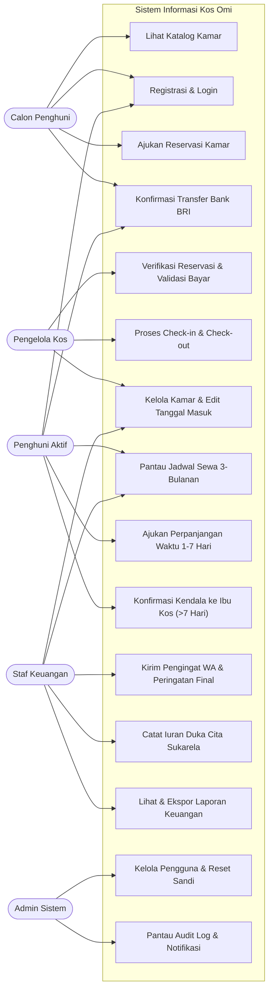
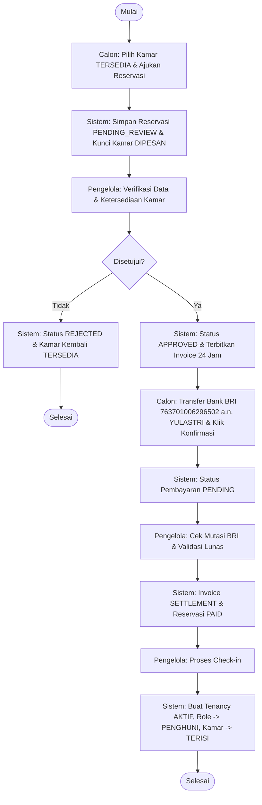
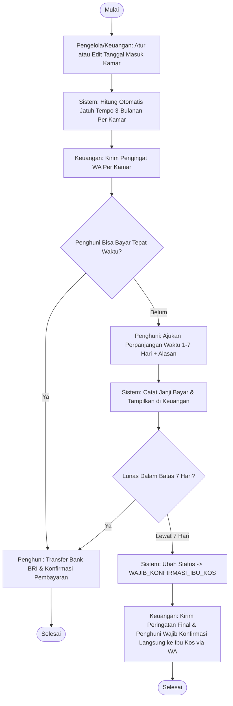
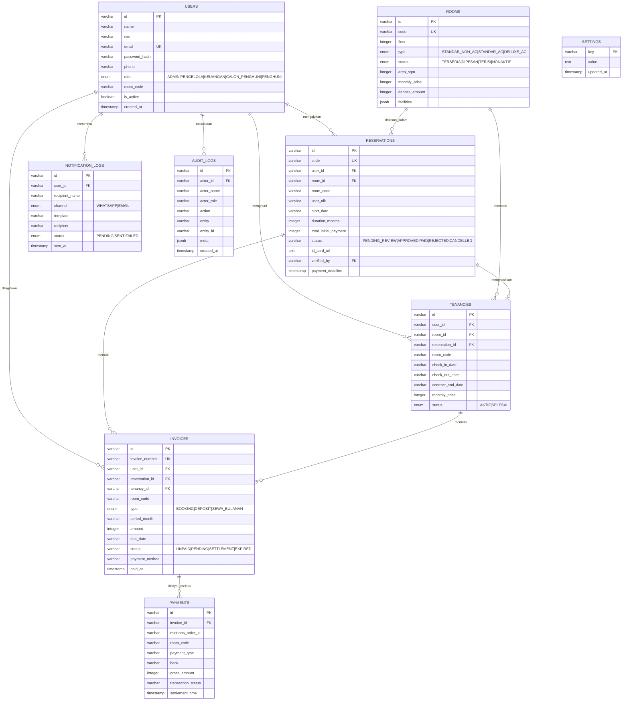

# Panduan Alur Sistem & Spesifikasi Diagram Laporan — Sistem Informasi Kos Omi

Dokumen ini disusun berdasarkan kondisi **sistem terbaru** yang sudah live di **https://kos-omi-padang.netlify.app** (Database: Neon PostgreSQL, Autentikasi: NextAuth + Bcrypt, Pembayaran: Transfer Bank BRI `763701006296502` a.n. **YULASTRI** + QRIS *Segera Hadir*).

Gunakan dokumen ini sebagai acuan langsung untuk menggambar **Use Case Diagram**, **Activity Diagram**, dan **ERD** di Draw.io, StarUML, Lucidchart, Visio, atau Mermaid Live.

---

## 1. Use Case Diagram (5 Aktor / Role)

Sistem Kos Omi memiliki **5 aktor resmi**:
1. **Calon Penghuni** (`CALON_PENGHUNI`)
2. **Penghuni Aktif** (`PENGHUNI`)
3. **Pengelola Kos** (`PENGELOLA`)
4. **Staf Keuangan** (`KEUANGAN`)
5. **Admin Sistem** (`ADMIN`)

### Daftar Use Case Per Aktor

| Aktor | Daftar Use Case |
| :--- | :--- |
| **Calon Penghuni** | • Melihat Katalog & Detail Kamar Tersedia • Registrasi Akun & Login • Mengajukan Reservasi Kamar (Data Diri & Kontak Darurat — tanpa unggah KTP/KTM/KRS) • Melihat Status & Timeline Reservasi • Melakukan Konfirmasi Transfer Bank BRI • Mengajukan Reset Kata Sandi via WhatsApp Admin |
| **Penghuni Aktif** | • Login & Personalisasi Profil (Ubah Email Pribadi, WhatsApp, & Kata Sandi) • Melihat Informasi Kamar & Jadwal Sewa 3-Bulanan • Melihat Tagihan & Melakukan Konfirmasi Pembayaran Bank BRI • Mengajukan Perpanjangan Waktu Bayar (1–7 Hari + Alasan) • Konfirmasi Kendala Langsung ke Ibu Kos via WhatsApp (jika lewat 7 hari) • Mencetak / Melihat Kuitansi & Riwayat Pembayaran |
| **Pengelola Kos** | • Mengelola Katalog & Status Kamar (Tersedia, Dipesan, Terisi, Nonaktif) • Memverifikasi Reservasi Masuk (Setujui / Tolak) • Memvalidasi Pembayaran Reservasi Bank BRI • Memproses Check-in (Mengubah Calon menjadi Penghuni Aktif) • Mengedit Tanggal Masuk Kamar (Sinkron otomatis ke jadwal 3-bulanan Keuangan) • Memproses Check-out (Mengosongkan Kamar kembali menjadi Tersedia) • Melihat Daftar Penghuni Aktif & Akun Calon Terdaftar |
| **Staf Keuangan** | • Melihat Dashboard Ringkasan Pendapatan Sewa • Mengelola Jadwal Tagihan Sewa 3-Bulanan Per Kamar • Mengedit Tanggal Masuk Kamar • Mengirim Pengingat Tagihan via WhatsApp Per Kamar & Peringatan Final (>7 Hari) • Melihat Riwayat Pembayaran Sewa & Detail Transaksi • Mencatat & Mengelola Iuran Sosial / Duka Cita Sukarela (Terpisah dari Sewa) • Melihat & Mengekspor Laporan Keuangan |
| **Admin Sistem** | • Mengelola Seluruh Akun Pengguna 5 Role (Tambah, Ubah Role, Aktif/Nonaktif) • Mereset Kata Sandi Pengguna (Bcrypt Hash) • Memantau Log Aktivitas Sistem (Audit Trail) • Memantau Log Notifikasi WhatsApp / Email • Mengelola Pengaturan Sistem Kos Omi |

### Visualisasi Use Case (Mermaid Flowchart)

---

## 2. Activity Diagram (5 Alur Proses Utama)

### Alur A: Reservasi Kamar, Pembayaran Bank BRI, hingga Check-in
**Swimlane:** `Calon Penghuni` | `Sistem` | `Pengelola Kos`

1. **Calon Penghuni** membuka katalog kamar, memilih kamar berstatus `TERSEDIA`, lalu mendaftar akun / login.
2. **Calon Penghuni** mengisi formulir reservasi (nama, tanggal rencana masuk, tipe hunian, kontak darurat) tanpa perlu mengunggah KTP/KTM/KRS, lalu mengirim pengajuan.
3. **Sistem** menyimpan reservasi dengan status `PENDING_REVIEW`, mengubah status kamar menjadi `DIPESAN`, dan mencatat log notifikasi untuk Pengelola.
4. **Pengelola Kos** membuka menu Reservasi Masuk dan memeriksa data calon penghuni serta ketersediaan kamar.
5. **Decision (Disetujui?):**
   - Jika **Ditolak**: **Sistem** mengubah status reservasi menjadi `REJECTED` dan mengembalikan status kamar menjadi `TERSEDIA`. *(Selesai)*
   - Jika **Disetujui**: **Sistem** mengubah status menjadi `APPROVED` dan menerbitkan **Invoice Pembayaran** (batas waktu 24 jam).
6. **Calon Penghuni** menyalin nomor rekening **Bank BRI `763701006296502` a.n. YULASTRI**, melakukan transfer, lalu klik **Konfirmasi Sudah Transfer Bank BRI**.
7. **Sistem** mengubah status pembayaran menjadi `PENDING` (Menunggu Validasi Pengelola).
8. **Pengelola Kos** mengecek mutasi rekening BRI dan klik **Validasi Pembayaran Lunas**.
9. **Sistem** mengubah status invoice menjadi `SETTLEMENT` dan reservasi menjadi `PAID`.
10. **Pengelola Kos** memproses **Check-in** saat penghuni tiba di kos.
11. **Sistem** membuat data kontrak aktif (`tenancies`), mengubah role akun menjadi `PENGHUNI`, dan mengubah status kamar menjadi `TERISI`.

---

### Alur B: Siklus Tagihan 3-Bulanan, Pengajuan Tempo (1–7 Hari), & Konfirmasi Ibu Kos
**Swimlane:** `Pengelola / Keuangan` | `Sistem` | `Penghuni Aktif` | `Ibu Kos`

1. **Pengelola / Keuangan** mengatur atau mengedit **Tanggal Masuk** kamar (`checkInDate`).
2. **Sistem** otomatis menghitung **Jatuh Tempo Sewa 3-Bulanan** di tanggal yang sama setiap 3 bulan sekali dan menyinkronkannya ke halaman Keuangan dan Portal Penghuni.
3. Mendekati jatuh tempo (H-7 s/d hari H), **Staf Keuangan** mengirim **Pengingat WhatsApp** per kamar (tercatat di `notification_logs` & `audit_logs`).
4. **Decision (Penghuni sudah bisa bayar?):**
   - Jika **Ya**: **Penghuni** melakukan transfer Bank BRI dan konfirmasi bayar → tagihan selesai.
   - Jika **Belum**: **Penghuni** membuka `/penghuni/tagihan`, memilih **Ajukan Perpanjangan Waktu (1–7 Hari)**, mengisi alasan singkat, dan mengirim.
5. **Sistem** memperbarui batas akhir bayar sesuai hari yang dipilih dan menampilkan alasan di halaman Staf Keuangan.
6. **Decision (Sudah lunas dalam batas 7 hari?):**
   - Jika **Ya**: Status kembali aman setelah pelunasan.
   - Jika **Tidak (> 7 hari)**: **Sistem** otomatis mengubah status menjadi **`WAJIB_KONFIRMASI_IBU_KOS`**.
7. **Staf Keuangan** mengirim **Peringatan Final (>7 Hari)**, dan **Penghuni** melihat banner wajib menghubungi **Ibu Yulastri (`0822-8714-6763`)** secara langsung via WhatsApp untuk menjelaskan kendala.

---

### Alur C: Pencatatan Iuran Sosial / Duka Cita Sukarela
**Swimlane:** `Staf Keuangan` | `Sistem`

1. Saat ada musibah atau keluarga penghuni kos yang meninggal dunia, anak kos mengumpulkan sumbangan sukarela (seikhlasnya).
2. **Staf Keuangan** membuka menu **Riwayat Pembayaran** → tab **Iuran Duka Cita**.
3. **Staf Keuangan** klik **Catat Iuran Duka Cita** dan mengisi nama kegiatan duka cita, nama penyumbang, nomor kamar, nominal, metode penyerahan (Tunai / Transfer / DANA), dan tanggal.
4. **Sistem** menyimpan data secara persisten ke database (`settings` key `social_donations_json`), menambahkan ke total dana sosial terkumpul (terpisah 100% dari pendapatan sewa kamar), dan mencatat ke `audit_logs`.

---

### Alur D: Check-out Penghuni & Pemulihan Kata Sandi
- **Check-out:** Pengelola memilih penghuni aktif di `/pengelola/checkout` → Sistem mengubah status `tenancies` menjadi `SELESAI`, mengisi `checkOutDate`, dan jika kamar tidak memiliki penghuni aktif lain, mengubah status kamar kembali menjadi `TERSEDIA`.
- **Lupa Kata Sandi:** Pengguna membuka `/lupa-password` → memasukkan email terdaftar → Sistem mencatat permintaan reset ke log notifikasi & audit → Pengguna menghubungi Admin via WhatsApp → Admin mereset kata sandi di `/admin/pengguna` (tersimpan dalam hash Bcrypt) → Pengguna login kembali dan mengganti sandi pribadi di halaman Profil.

---

## 3. Entity Relationship Diagram (ERD) — 9 Tabel Neon PostgreSQL

Struktur di bawah ini **100% sesuai** dengan file skema database [schema.ts](file:///d:/kos_omi/src/db/schema.ts).

### Relasi Antar Entitas (Kardinalitas)
1. `users` **1 : N** `reservations` (`users.id` → `reservations.user_id` & `reservations.verified_by`)
2. `rooms` **1 : N** `reservations` (`rooms.id` → `reservations.room_id`)
3. `users` **1 : N** `tenancies` (`users.id` → `tenancies.user_id`)
4. `rooms` **1 : N** `tenancies` (`rooms.id` → `tenancies.room_id`) — *(mendukung 1 kamar dihuni 1–2 orang)*
5. `reservations` **1 : 0..1** `tenancies` (`reservations.id` → `tenancies.reservation_id`)
6. `users` **1 : N** `invoices` (`users.id` → `invoices.user_id`)
7. `reservations` **1 : N** `invoices` (`reservations.id` → `invoices.reservation_id`)
8. `tenancies` **1 : N** `invoices` (`tenancies.id` → `invoices.tenancy_id`)
9. `invoices` **1 : N** `payments` (`invoices.id` → `payments.invoice_id`)
10. `users` **1 : N** `notification_logs` (`users.id` → `notification_logs.user_id`)
11. `users` **1 : N** `audit_logs` (`users.id` → `audit_logs.actor_id`)
12. `settings` (tabel konfigurasi mandiri *key-value*, menyimpan konfigurasi sistem, data perpanjangan tempo kamar `room_rent_meta_json`, dan catatan iuran duka cita `social_donations_json`).

### Visualisasi ERD (Mermaid `erDiagram`)

---

## 4. Prompt Siap Pakai (Copy-Paste ke Tools Pembuat Diagram)

Jika kamu ingin membuat gambar diagram secara otomatis di **Draw.io (AI)**, **Eraser.io**, **Mermaid Live**, atau **PlantUML**, salin prompt berikut:

> **Prompt Use Case Diagram:**
> Buatkan Use Case Diagram untuk "Sistem Informasi Manajemen Kos Omi" dengan 5 aktor: Calon Penghuni, Penghuni Aktif, Pengelola Kos, Staf Keuangan, dan Admin Sistem.
> - Calon Penghuni: Lihat Katalog Kamar, Registrasi & Login, Ajukan Reservasi Kamar (Data Diri & Kontak Darurat), Konfirmasi Transfer Bank BRI.
> - Penghuni Aktif: Login & Edit Profil, Lihat Jadwal Sewa 3-Bulanan, Bayar Sewa via Transfer Bank BRI, Ajukan Perpanjangan Waktu (1-7 Hari), Konfirmasi Kendala Langsung ke Ibu Kos via WhatsApp (jika >7 hari), Cetak Kuitansi.
> - Pengelola Kos: Kelola Katalog & Status Kamar, Verifikasi Reservasi (Setujui/Tolak), Validasi Pembayaran BRI, Proses Check-in & Check-out, Edit Tanggal Masuk Kamar.
> - Staf Keuangan: Kelola Jadwal Tagihan 3-Bulanan Per Kamar, Edit Tanggal Masuk Kamar, Kirim Pengingat WA & Peringatan Final (>7 Hari), Lihat Riwayat Pembayaran Sewa, Catat Iuran Duka Cita Sukarela (Terpisah dari Sewa), Ekspor Laporan Keuangan.
> - Admin Sistem: Kelola Pengguna 5 Role, Reset Kata Sandi Pengguna, Pantau Audit Log & Log Notifikasi, Kelola Pengaturan Sistem.

> **Prompt Activity Diagram:**
> Buatkan 2 Activity Diagram dengan swimlane untuk Sistem Informasi Kos Omi:
> 1. Alur Reservasi hingga Check-in (Swimlane: Calon Penghuni, Sistem, Pengelola Kos): Pilih kamar tersedia -> Ajukan reservasi dengan data diri & kontak darurat -> Sistem ubah kamar jadi Dipesan -> Pengelola verifikasi data (jika ditolak kamar kembali Tersedia; jika disetujui terbit Invoice 24 jam) -> Calon transfer ke Bank BRI 763701006296502 a.n. YULASTRI dan klik konfirmasi -> Pengelola validasi mutasi BRI -> Status Lunas -> Pengelola proses Check-in -> Sistem buat kontrak aktif, ubah role menjadi Penghuni Aktif, dan ubah kamar menjadi Terisi.
> 2. Alur Tagihan Sewa 3-Bulanan & Pengajuan Tempo (Swimlane: Pengelola/Keuangan, Sistem, Penghuni Aktif, Ibu Kos): Atur/edit tanggal masuk kamar -> Sistem hitung otomatis jatuh tempo setiap 3 bulan -> Keuangan kirim pengingat WA per kamar -> Jika penghuni belum bisa bayar, penghuni ajukan perpanjangan waktu maksimal 1-7 hari beserta alasan -> Jika lewat 7 hari belum lunas, sistem otomatis mengubah status menjadi Wajib Konfirmasi Ibu Kos -> Keuangan kirim peringatan final dan penghuni wajib menghubungi Ibu Kos langsung via WhatsApp.

> **Prompt ERD:**
> Buatkan Entity Relationship Diagram (Crow's Foot Notation) untuk database PostgreSQL Sistem Informasi Kos Omi yang terdiri dari 9 tabel: `users`, `rooms`, `reservations`, `tenancies`, `invoices`, `payments`, `notification_logs`, `audit_logs`, dan `settings`. Relasi: `users` (1:N) `reservations`, `rooms` (1:N) `reservations`, `users` (1:N) `tenancies`, `rooms` (1:N) `tenancies`, `reservations` (1:0..1) `tenancies`, `users` (1:N) `invoices`, `reservations` (1:N) `invoices`, `tenancies` (1:N) `invoices`, `invoices` (1:N) `payments`, `users` (1:N) `notification_logs`, `users` (1:N) `audit_logs`, dan `settings` sebagai tabel key-value untuk konfigurasi sistem, data tempo kamar, serta catatan iuran duka cita sukarela.
